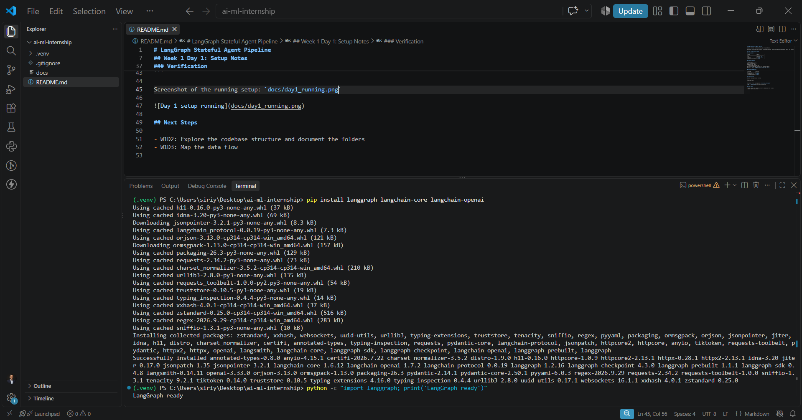
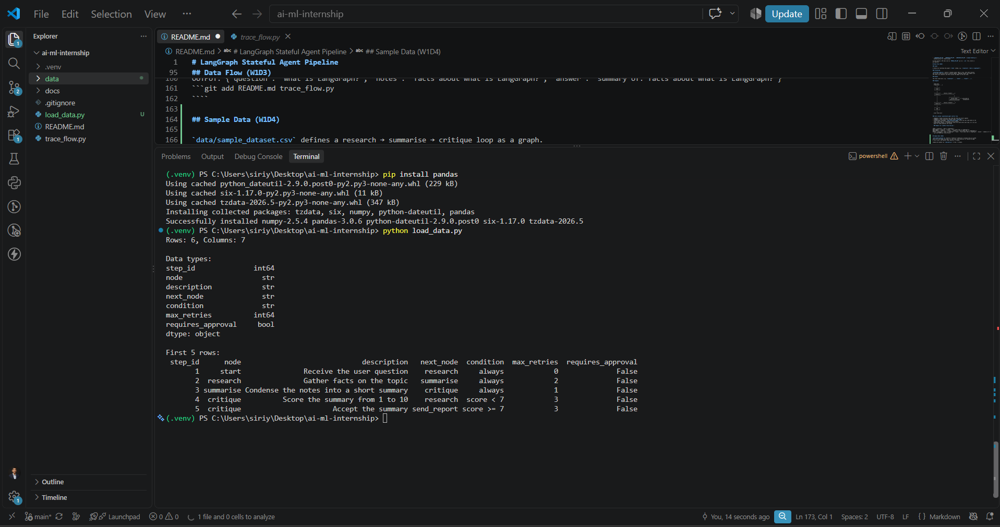

# LangGraph Stateful Agent Pipeline

Cynaris Solutions AI/ML Internship, by Siriyala Nishar.

A stateful multi-step agent pipeline built with LangGraph, featuring conditional branching, memory, and human-in-the-loop checkpoints for business workflow automation.

## Week 1 Day 1: Setup Notes

### Environment

| Item                | Value           |
| ------------------- | --------------- |
| OS                  | Windows `11`    |
| Python              | `Python 3.14.7` |
| Editor              | VS Code         |
| Virtual environment | `.venv`         |

### Setup Commands

```powershell
mkdir ai-ml-internship
cd ai-ml-internship
python -m venv .venv
.\.venv\Scripts\Activate.ps1
pip install langgraph langchain-core langchain-openai
python -c "import langgraph; print('LangGraph ready')"
```

### Installed Versions

| Package          | Version  |
| ---------------- | -------- |
| langgraph        | `1.2.16` |
| langchain-core   | `1.6.12` |
| langchain-openai | `1.7.2`  |

### Verification

Running the import check printed:

```
LangGraph ready
```

Screenshot of the running setup: `docs/day1_running.png`



## Codebase Structure (W1D2)

Explored the installed `langgraph` package (v1.2.16, Python 3.14), located at
`.venv/Lib/site-packages/langgraph`.

### Folder structure

- `graph/`: defines `StateGraph`, nodes, edges and conditional branching
- `pregel/`: the execution engine that runs a compiled graph step by step
- `channels/`: state channels that store and merge values between nodes
- `checkpoint/`: saving and restoring graph state (persistence and memory)
- `store/`: long-term key-value memory shared across threads
- `prebuilt/`: ready-made components such as ReAct agents and tool nodes
- `cache/`: caching of node results
- `stream/`: streaming of output while the graph runs
- `func/`: functional API (`@entrypoint` / `@task`) as an alternative to graphs
- `managed/`: managed values such as `is_last_step`
- `utils/`: helpers for configs and runnables
- `_internal/`: private helpers (caching, retries, timeouts, serialization)

### Entry point

`langgraph/graph/__init__.py` exposes `StateGraph`, which is defined in
`graph/state.py`. A library has no `main.py`, so this is the API entry point.

### Key modules

1. `graph/state.py`: the `StateGraph` class used to build a pipeline
2. `pregel/main.py`: the `Pregel` runtime that executes the compiled graph
3. `checkpoint/`: persistence that lets a graph pause and resume (needed for
   human-in-the-loop in this project)

### Configuration

LangGraph has no config file. It reads environment variables instead:

- `LANGGRAPH_DEFAULT_RECURSION_LIMIT` (`_internal/_config.py`): max steps per run
- `LANGGRAPH_STRICT_MSGPACK` (`checkpoint/serde/_msgpack.py`): stricter checkpoint
  deserialization
- `LANGGRAPH_AES_KEY` (`checkpoint/serde/encrypted.py`): key for encrypted checkpoints
- `LANGGRAPH_API_KEY`, `LANGSMITH_API_KEY`, `LANGCHAIN_API_KEY` (`pregel/remote.py`):
  authentication for remote graphs

In this project, API keys such as `OPENAI_API_KEY` go in a `.env` file, which is
git-ignored.

## Data Flow (W1D3)

### Input

A Python dict matching the graph's `State` schema, e.g. `{"question": "what is LangGraph?"}`.

### Processing

`StateGraph.compile()` builds a runnable graph. When it runs, each node receives
the current state and returns a partial update. LangGraph merges that update into
the state (via channels) and then follows the edges to the next node.

### Output

The final state dict, e.g. `{"question": ..., "notes": ..., "answer": ...}`.

### Diagram

```
  input dict
  {"question": ...}
        |
        v
   +---------+
   |  START  |
   +---------+
        |
        v
   +----------+      returns {"notes": ...}
   | research | ------------------------+
   +----------+                          |
        |                                v
        |                      +------------------+
        |                      |   shared STATE   |  <-- persisted by
        |                      | question|notes|ans|      checkpointer
        |                      +------------------+
        v                                ^
   +-----------+     returns {"answer": ...}
   | summarise | ------------------------+
   +-----------+
        |
        v
   +---------+
   |   END   |
   +---------+
        |
        v
  final state dict
```

### Core concept: graph-based agent control flow

- **Nodes**: Python functions that read the state and return updates
- **Edges**: fixed transitions between nodes (`add_edge`)
- **Conditional routing**: `add_conditional_edges` picks the next node based on the
  state (used later for branching in this project)
- **Persistent state**: a checkpointer saves the state after each step, so a run can
  pause for human approval and resume

  ### Sample run (`python trace_flow.py`)

````
INPUT: {'question': 'what is LangGraph?'}
NODE UPDATE: {'research': {'notes': 'facts about what is LangGraph?'}}
NODE UPDATE: {'summarise': {'answer': 'summary of: facts about what is LangGraph?'}}
OUTPUT: {'question': 'what is LangGraph?', 'notes': 'facts about what is LangGraph?', 'answer': 'summary of: facts about what is LangGraph?'}
```git add README.md trace_flow.py
````

## Sample Data (W1D4)

`data/sample_dataset.csv` defines a research → summarise → critique loop as a graph.
Each row is one edge: the node, its next node, the condition for taking the edge,
a retry limit, and whether human approval is needed.

Loaded with pandas via `load_data.py`: 6 rows, 7 columns.



## Week 1 Output (W1D5)

This project runs a LangGraph StateGraph with three nodes (research, summarise, critique)
and a conditional edge that loops back to research until the critique score reaches 7.
It uses `data/sample_dataset.csv`, which defines the loop's steps, conditions and retry limit.
Running `python week1_run.py` prints the state at each step and saves the step log to
`results/week1_results.csv` (screenshot: `docs/week1_output.png`).

## Exploratory Data Analysis (W2D1)

`notebooks/week2_day1_eda.ipynb` explores `data/sample_dataset.csv`.

### EDA summary

- The dataset has 6 rows and 7 columns; each row is one edge of the research → summarise → critique loop.
- Only 3 columns are numeric or boolean (`step_id`, `max_retries`, `requires_approval`); the rest are text.
- `max_retries` ranges from 0 to 3 (mean 1.5); the critique steps have the highest value (3).
- The target `requires_approval` is imbalanced: 5 rows are False and 1 is True (only `send_report`).
- No column has missing values, so none is above the 5% threshold.

### Top 3 correlations

| Pair                                 | Correlation |
| ------------------------------------ | ----------- |
| `step_id` vs `requires_approval`     | 0.65        |
| `max_retries` vs `requires_approval` | -0.53       |
| `step_id` vs `max_retries`           | 0.19        |

### Limitation

With only 6 rows and 3 numeric columns, these correlations are not statistically
meaningful. The dataset will need to grow before modelling work in later days.

## Handling Missing Data on the Loan Dataset (W2D2)

Dataset: Kaggle "Loan Prediction Problem" (`data/loan_approval.csv`), 614 rows and 13 columns.
Target: `Loan_Status` (Y = approved, N = rejected).

`clean_loan_data.py` found missing values in 7 columns: `Credit_History` (50),
`Self_Employed` (32), `LoanAmount` (22), `Dependents` (15), `Loan_Amount_Term` (14),
`Gender` (13) and `Married` (3). Numeric columns were filled with the median and text
columns with the mode; no column exceeded 40% missing, so none was dropped.
The script asserts zero missing values before saving `data/cleaned_loan_dataset.csv`.

Note: `Credit_History` is really a 0/1 category, so the median fill sets missing rows
to 1, the most common value.

`data/sample_dataset.csv` remains the pipeline data from Week 1; the loan dataset is
used for the Week 2 and Week 3 modelling tasks.

## Feature Engineering (W2D3)

`notebooks/feature_engineering.ipynb` adds four features to the cleaned loan data:
`TotalIncome` (applicant + coapplicant income), `LoanAmount_to_Income` (affordability ratio),
`LogTotalIncome` (log transform to reduce skew), and `Income_Band` (4 equal-sized bands).

The log transform reduces skew from 6.5 to 1.1. `LoanAmount_to_Income` has the strongest
correlation with approval of the new features (-0.09); `Income_Band` shows almost no signal.
`Credit_History` (0.54) remains the strongest predictor overall. The result is saved to
`data/featured_loan_dataset.csv`.

## Scaling (W2D4)

`notebooks/scaling.ipynb` splits the featured loan data 80/20 (stratified) and fits a
`StandardScaler` on the training rows only, to avoid leaking test information. The 7
continuous numeric features are scaled; `Credit_History` (0/1) is left unchanged.

Training features end with mean 0 and std 1. Scaling does not change skew (the W2D3 log
transform does), and `MinMaxScaler` was not needed since no planned model requires
[0, 1] inputs. The fitted scaler is saved to `models/scaler.pkl` for the pipeline and
serving.

## End-to-End Preprocessing Pipeline (W2D5)

`preprocessing/pipeline.py` exposes `preprocess(df)`, which takes the raw loan DataFrame and returns `X, y`:
fills missing values with fixed constants (W2D2), adds `TotalIncome`, `LoanAmount_to_Income`
and `LogTotalIncome` (W2D3), scales the continuous features with `models/scaler.pkl` (W2D4),
and one-hot encodes the categorical columns. `y` is 1 for approved and 0 for rejected.

Running `python preprocessing/pipeline.py` processes `data/loan_approval.csv` end to end
(614 rows, 17 feature columns). `Income_Band` is not used because it showed almost no signal.
