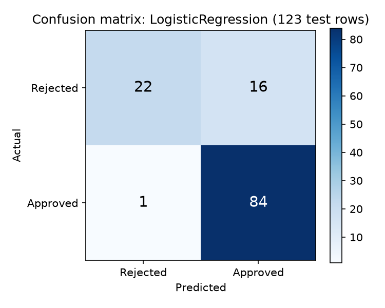

# Model Performance: LogisticRegression (tuned)

Date: 2026-11-13
Task: predict whether a loan application is approved (1) or rejected (0).

## How the numbers were produced
- **Held-out column:** the tuned settings refitted on the 491 training rows and scored on the 123 test rows
  (20% stratified split, `random_state=42`). `models/tuned_model.pkl` itself is retrained on all rows, so it
  cannot be scored on unseen data.
- **5-fold CV column:** predictions for all 614 rows, each made by a model that did not see that row.
  This is the more reliable figure because it uses five times as many rows.
- "Approved" is the positive class. Decision threshold 0.5.

## Metrics

| Metric | Held-out (123 rows) | 5-fold CV (614 rows) |
|--------|---------------------|----------------------|
| Accuracy | 0.862 | 0.808 |
| Precision (approved) | 0.840 | 0.796 |
| Recall (approved) | 0.988 | 0.969 |
| F1 (approved) | 0.908 | 0.874 |
| Specificity (rejected caught) | 0.579 | 0.453 |
| ROC AUC | 0.878 | 0.752 |

Held-out confusion matrix: 84 approved loans correctly approved, 22 rejected loans correctly rejected,
16 rejected loans wrongly approved, 1 approved loans wrongly rejected.

## Which metrics matter here
- **Accuracy is not enough.** The classes are imbalanced (about 69% approved), so always predicting
  "approved" already scores about 0.69.
- **Precision (approved)** answers: of the loans the model approves, how many should have been approved?
  A wrong approval is the costly mistake in lending.
- **Recall (approved)** answers: of the loans that should be approved, how many does the model approve?
  A wrong rejection loses a good customer.
- **Specificity** is the share of bad (rejected) applications the model catches, the other side of the same trade-off.
- **F1** balances precision and recall for the approved class.
- **ROC AUC** measures how well the model ranks applications, independent of the 0.5 threshold.
- RMSE and MAE do not apply, because this is classification.

## Interpretation
- The model leans heavily towards approving. Recall for approved loans is 0.99
  on the test rows, but specificity is only 0.58: 16 of the 38 rejected loans
  (42%) were wrongly approved. Over 5-fold CV the share of bad loans caught is
  0.45. Accuracy (0.862) hides this.
- Precision is 0.84 on the test rows (0.80 in CV), so between one in six
  and one in five approvals is wrong.
- The held-out numbers are higher than the cross-validated ones (accuracy 0.862 against
  0.808, AUC 0.878 against 0.752). With only 123 test rows the held-out
  figures are noisy, so rely on the CV column.

## Metric to optimise
**Precision for the approved class**, while keeping recall from collapsing (monitor F1).
A wrongly approved loan is a direct financial loss, whereas a wrongly rejected one is a missed opportunity,
and in this project a rejected or borderline case can also be sent to a human reviewer (the
human-in-the-loop enhancement). ROC AUC is used to compare models because it does not depend on the threshold.

The models so far were tuned for accuracy, which rewards approving almost everything on imbalanced data.
Next steps: raise the decision threshold above 0.5 or use `class_weight="balanced"`, and re-tune for
precision, F1 or AUC instead of accuracy.

## Caveats
- Test set of 123 rows: one loan changes precision or recall by about one percentage point or more.
- Features include `Gender` and `Married`; a fairness review is needed before any real use.
